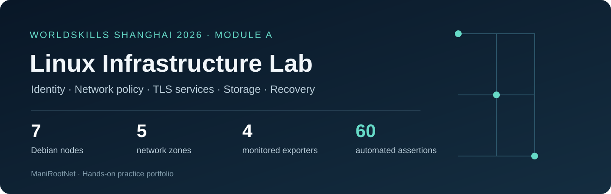
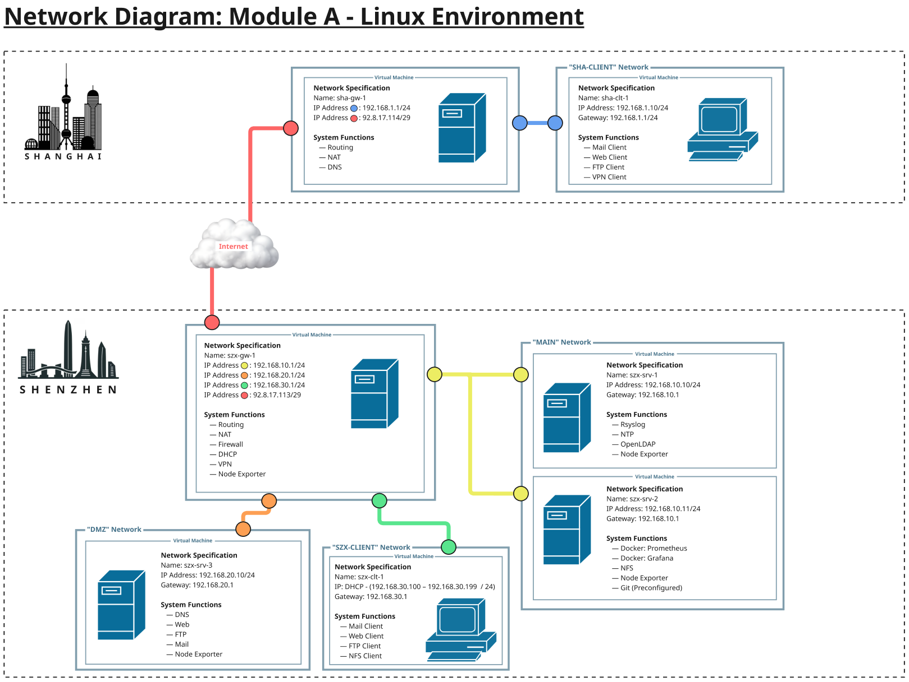
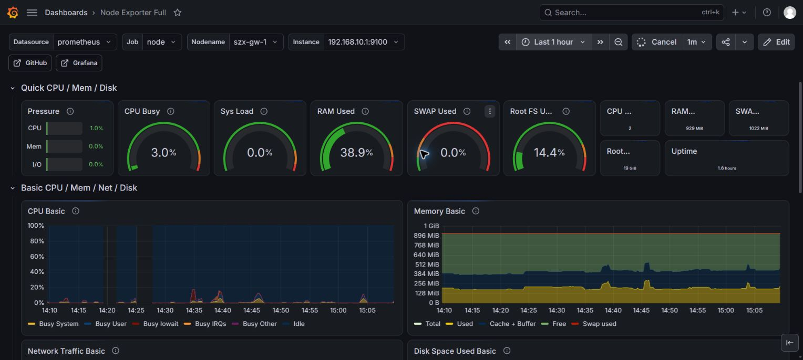

# Shanghai 2026 · Linux Infrastructure Lab

A seven-node Debian lab connecting Shanghai and Shenzhen, built as part of my preparation for **WorldSkills IT Network Systems Administration**.

This project brings routing, directory-backed access, encrypted services, monitoring, resilient storage and recovery into one working environment. The evidence follows traffic and authentication across the lab, including permitted access, rejected access and recovery after deliberate configuration drift.

**60 automated assertions passed** across service access, TLS, DNS and directory integration. Additional operational drills cover VPN routing, firewall behavior, traffic shaping, RAID persistence and Ansible recovery.

[Architecture](docs/architecture.md) · [Validation results](docs/validation.md) · [Engineering notes](docs/engineering-notes.md) · [Machine-readable evidence](evidence/validation-summary.json)

## What the lab demonstrates

| Area | Implemented behavior |
| --- | --- |
| Network engineering | Five zones, routed connectivity, source NAT, prefix NAT and stateful segmentation |
| Identity | LDAPS with separate VPN, FTP and mail authorization groups |
| Encrypted services | HTTPS virtual hosts, explicit FTPS, authenticated SMTP submission and IMAP STARTTLS |
| Remote access | Directory-authenticated OpenVPN, pushed routes and a tested client lifecycle script |
| Observability | Four Node Exporters, Prometheus, Grafana, chrony and certificate-authenticated remote logging |
| Storage | Three-disk RAID5, ext4 and persistent NFS access with file-integrity verification |
| Recovery | Git-managed Ansible recovery, controlled drift repair and repeat-run validation |

## The original scenario topology

Source: WorldSkills Shanghai 2026, Skill 39, Module A test project, topology on page 7. See [attribution](NOTICE.md).

## Selected results

| Verification | Observed result |
| --- | --- |
| Automated service, DNS and directory checks | **60 / 60 passed** |
| Node Exporter coverage | **4 / 4 UP** |
| Web connection policy | Five combined HTTP/HTTPS sessions accepted; sixth blocked for the same source |
| Per-client web download | 6 MiB in 26.52 s, approximately **1.90 Mbit/s** |
| Per-client web upload | 6 MiB in 26.80 s, approximately **1.88 Mbit/s** |
| VPN | Both authorized users connected; non-member rejected; tunnel access verified |
| RAID5 | **3 / 3 active**, clean after reboot |
| NFS data | Original files retained identical SHA-256 hashes; client read/write succeeded |
| Recovery drill | Four injected drifts repaired; repeat run **changed=0, failed=0** |

The counts refer to the checks documented in this repository. They are independent practice-lab results.

## Live observability

A real capture from the running lab. [Target evidence](evidence/monitoring-targets.json) records all four monitored nodes.

## Explore the evidence

- [Validation report](docs/validation.md) explains positive, negative and persistence tests.
- [Selected terminal output](evidence/selected-terminal-output.txt) includes measured transfer rates, connection-limit behavior and recovery recaps.
- [Storage integrity evidence](evidence/storage-integrity.txt) records the assembled RAID and original-file checks after reboot.
- [Fresh-checkout recovery replay](evidence/recovery-replay.txt) and [served certificate fingerprints](evidence/served-certificates.json) add independent integration evidence.
- [Engineering notes](docs/engineering-notes.md) explain the integration decisions behind the results.

**Related portfolio:** [Shanghai 2026 Enterprise Network Lab · Cisco](https://github.com/ManiRootNet/shanghai-2026-enterprise-network-lab)

*Maintained by [ManiRootNet](https://github.com/ManiRootNet).*
