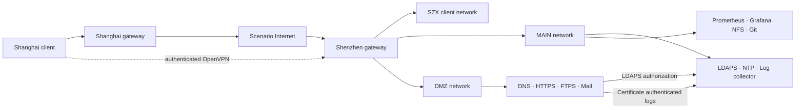

# Architecture

The lab contains seven Debian virtual machines across two sites and five network zones.

| Node | Role |
| --- | --- |
| szx-gw-1 | Shenzhen router, nftables policy, DHCP, OpenVPN, traffic control and recovery controller |
| szx-srv-1 | LDAPS identity, chrony reference and mutually authenticated remote log collection |
| szx-srv-2 | Prometheus, Grafana, Git service, NFS and RAID5 storage |
| szx-srv-3 | DMZ DNS, HTTPS, explicit FTPS and mail services |
| szx-clt-1 | DHCP client, NFS consumer, FTPS and mail client |
| sha-gw-1 | Shanghai routing, NAT, DNS forwarding and SSH protection |
| sha-clt-1 | Shanghai client and OpenVPN endpoint |

## Trust and traffic paths

## Access model

Client-originated traffic can reach the Shenzhen service networks. MAIN and DMZ cannot initiate new sessions toward the client network; established replies remain available.

| Group | Users | Authorized service |
| --- | --- | --- |
| VPN | user1, user2 | Remote network access |
| FTP | user3, user4 | Explicit FTPS with individual jailed homes |
| Mail | user5, user6 | Authenticated submission and mailbox access |

All six directory users can authenticate to the internal HTTPS application. Anonymous requests are rejected.

## Operational dependencies

- DNS resolves service names differently for internal and external clients.
- The shared wildcard certificate covers the root domain and subdomains. Key Usage, Extended Key Usage and trust stores are aligned with the consuming services.
- Prometheus scrapes all four Shenzhen server/gateway exporters. Grafana uses the canonical monitoring endpoint.
- NFS is backed by persistent three-disk RAID5 storage. File hashes are checked across the migration and reboot.
- The Shenzhen gateway runs the Ansible recovery workflow against the Shanghai gateway from the internal Git repository.
