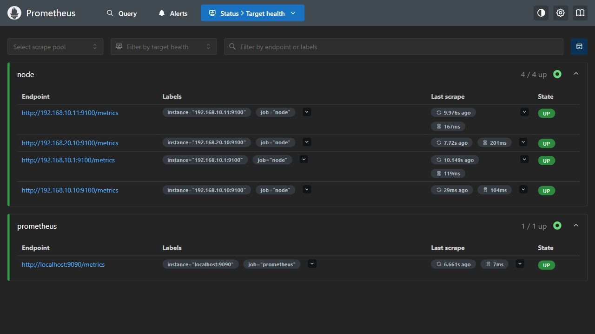
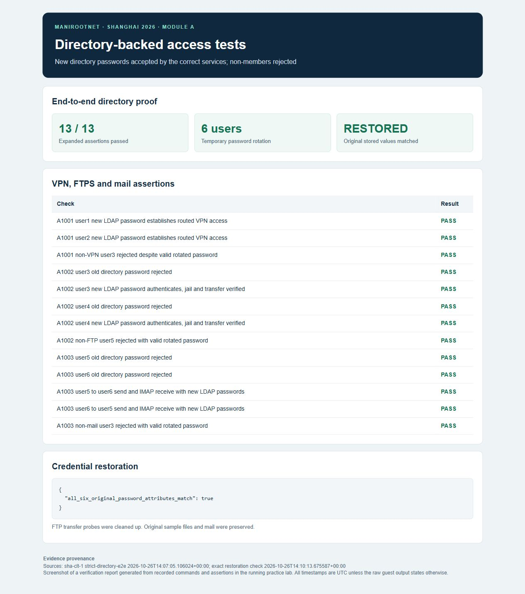
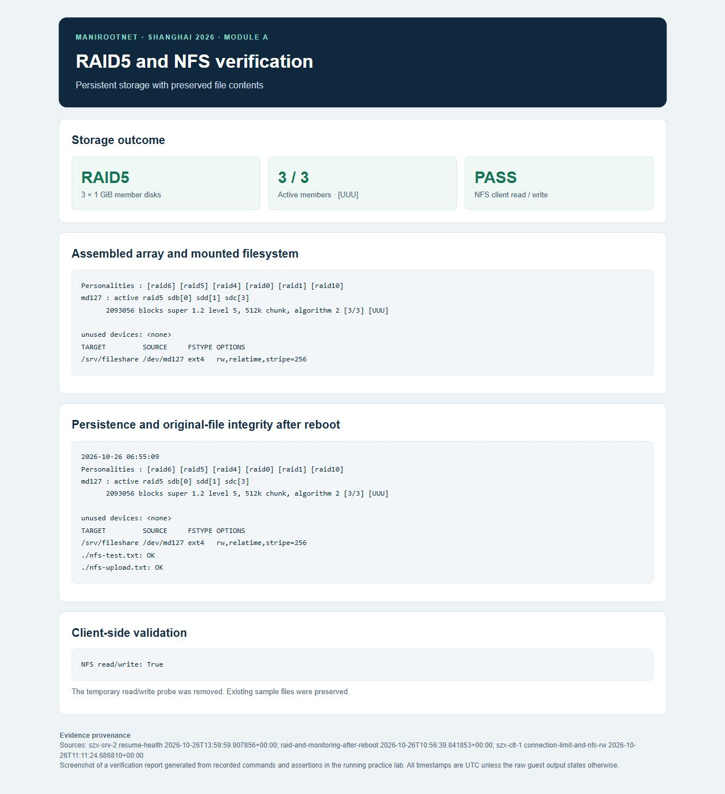
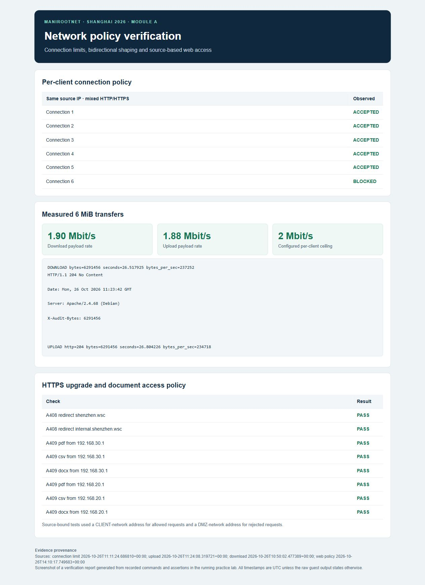
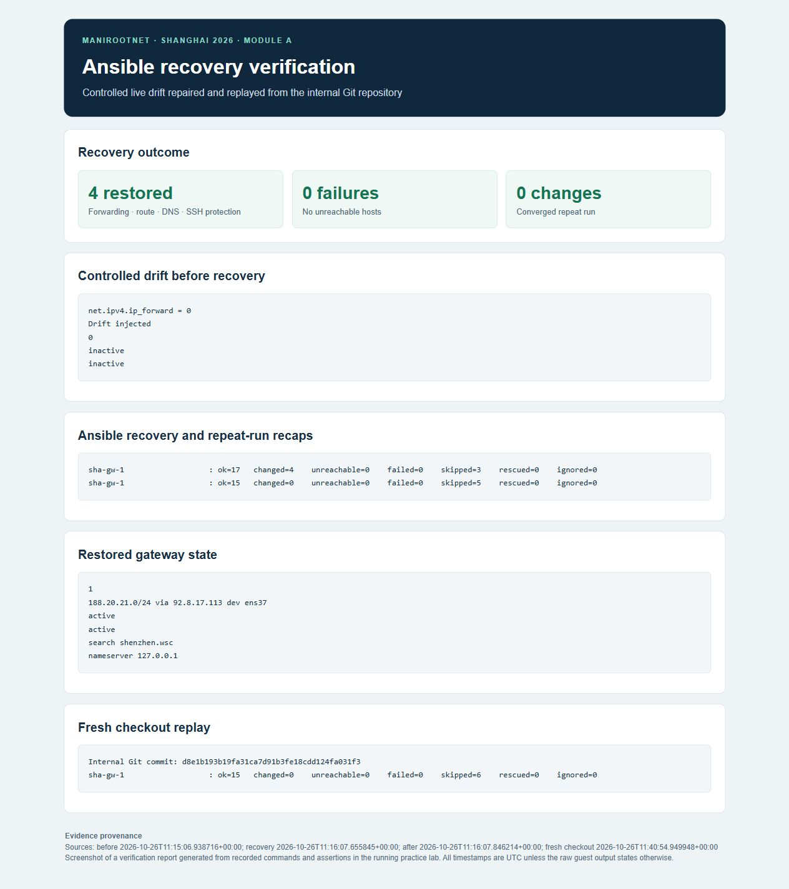

# Visual verification evidence

The Prometheus and Grafana images are direct captures of the running service interfaces. The other images are screenshots of verification reports built from recorded live test output, with source nodes and UTC capture times included. The reports retain the measured values and observed outcomes.

## Monitoring coverage

Four Node Exporters are UP. Prometheus also monitors itself.

## Directory-backed authorization

All 13 expanded checks passed. Both members of each service group were tested with temporary directory passwords. Mail was sent and received in both directions. Exact original password attributes were restored.

[Structured assertions](../evidence/extended-checks.json)

## Persistent storage and file integrity

The array remains clean after reboot, both original sample files match their saved hashes and client read/write succeeds.

[Storage output](../evidence/storage-integrity.txt)

## Network policy and measured traffic shaping

The sixth combined web connection is blocked. Upload and download measurements match the configured per-client ceiling. All eight redirect and document-policy checks passed.

[Measured output](../evidence/selected-terminal-output.txt)

## Recovery and convergence

Four controlled drifts were repaired. The repeat run and fresh-checkout replay reported no failed or unreachable hosts and zero further changes.

[Fresh-checkout evidence](../evidence/recovery-replay.txt)
